# HugMyFile

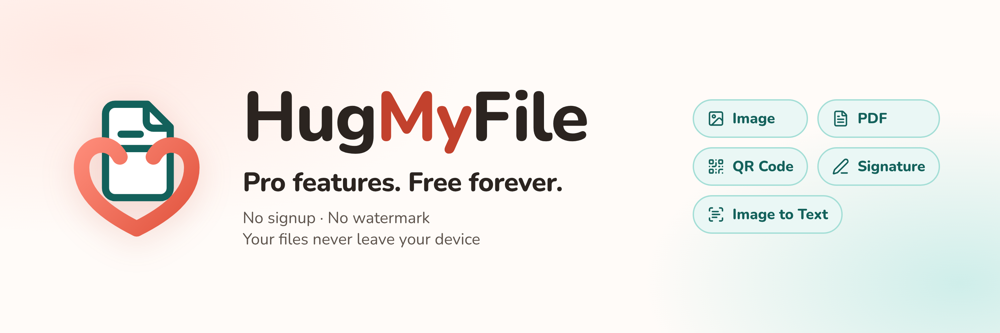

Free, private online tools for images, PDFs, QR codes, signatures and text recognition.
**Pro features. Free forever. No signup. No watermark. Your files never leave your device.**

Every tool runs entirely in the visitor's browser (Web Workers + WebAssembly). There is no
backend, no database, no accounts and no file uploads. The site is a static Astro build that
deploys to Cloudflare Pages.

## Screenshots

| | |
|---|---|
| 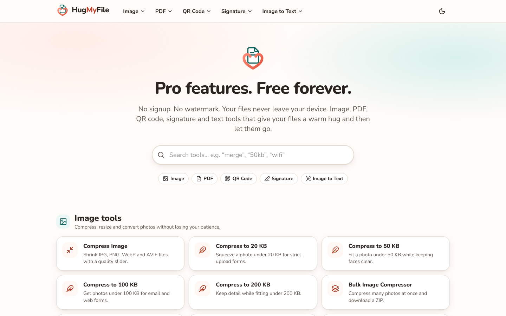 | 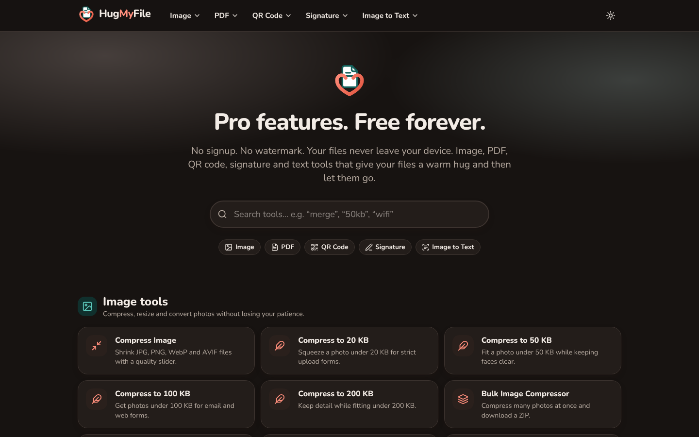 |
| 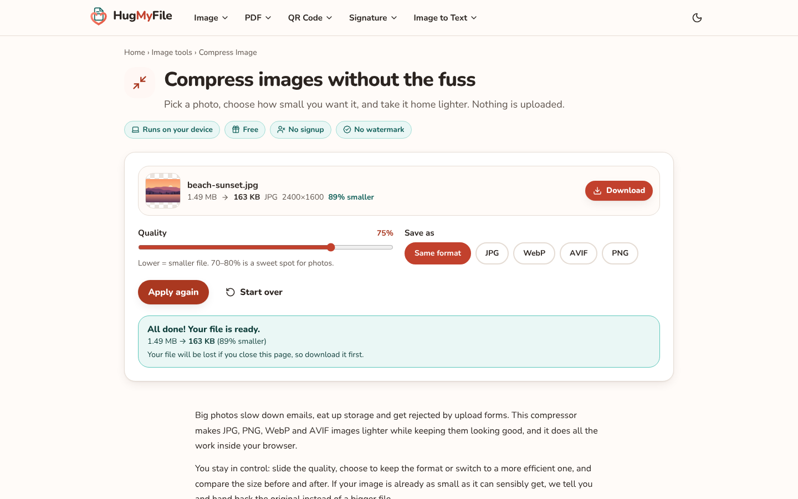 | 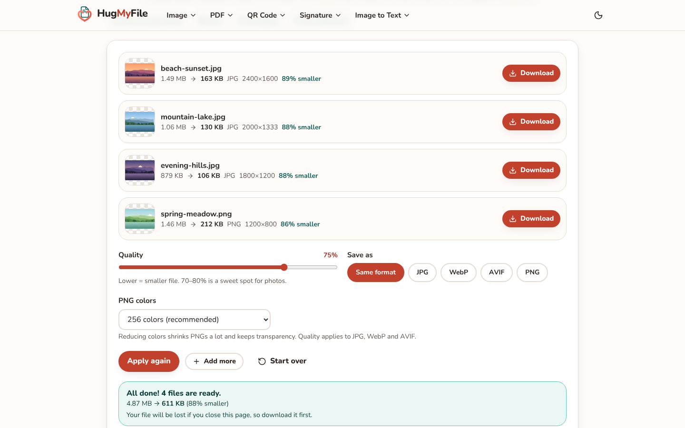 |
| 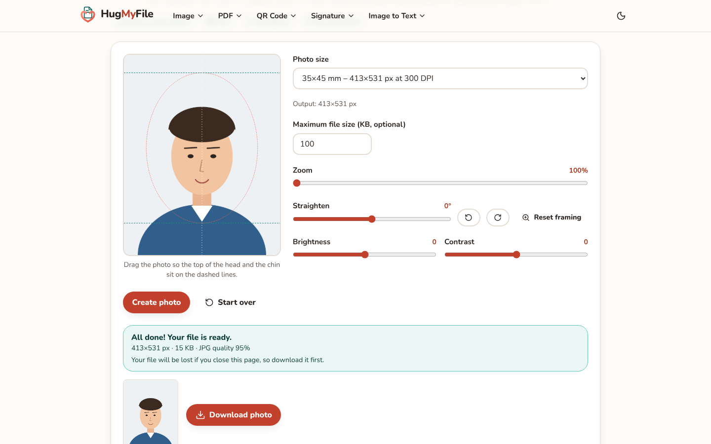 | 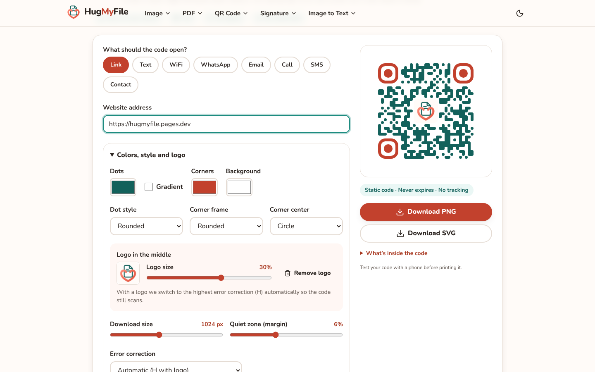 |
| 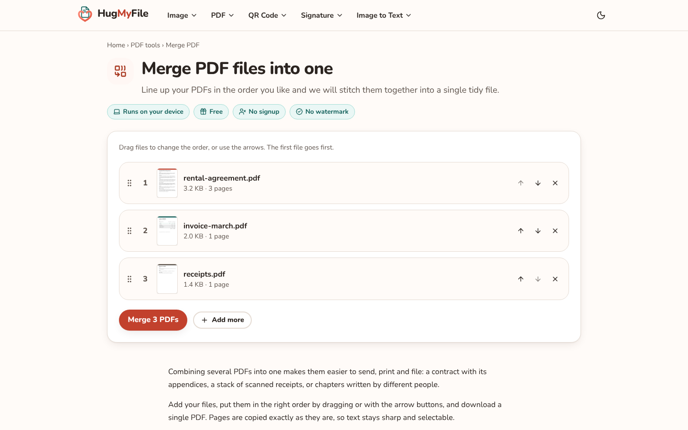 | 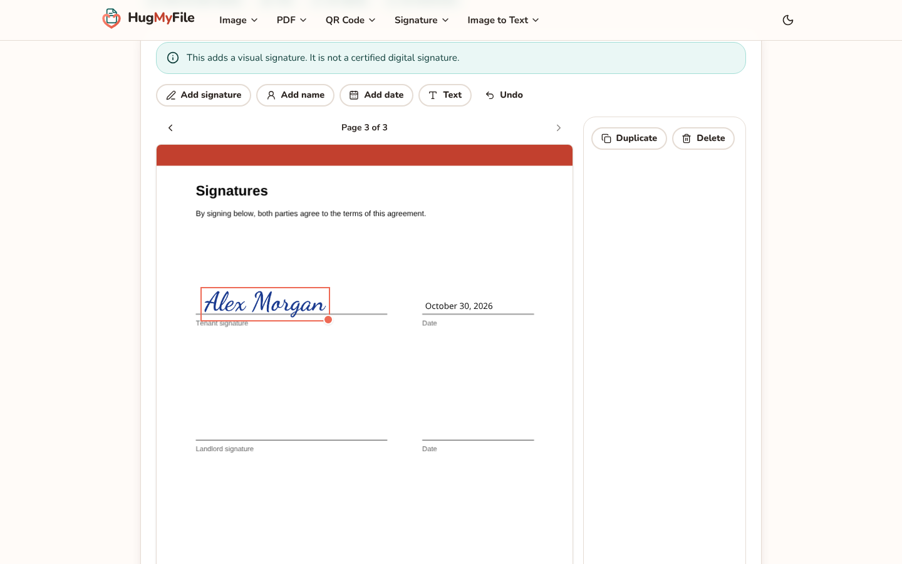 |
| 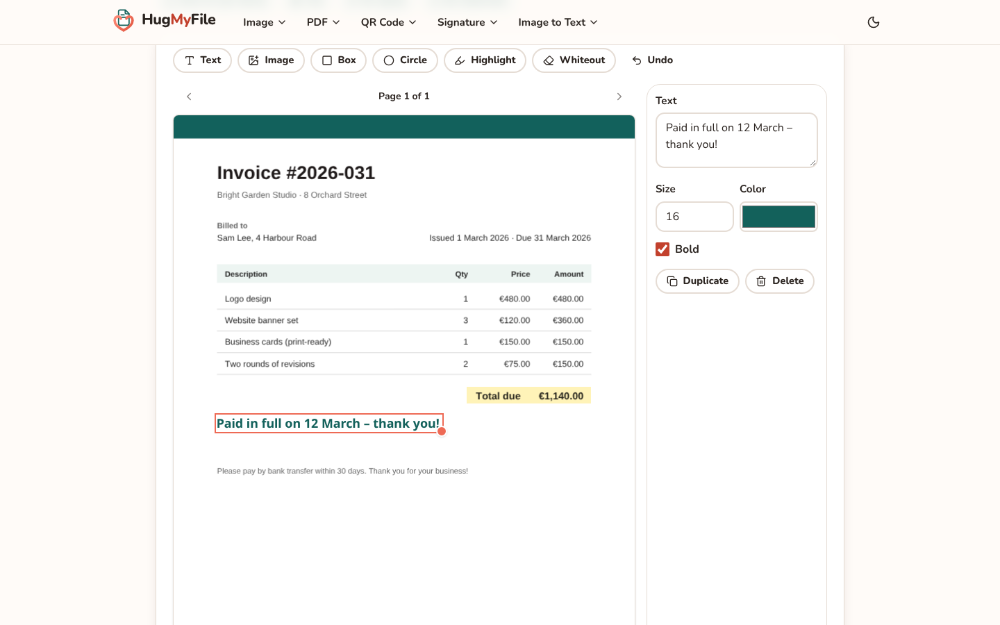 | 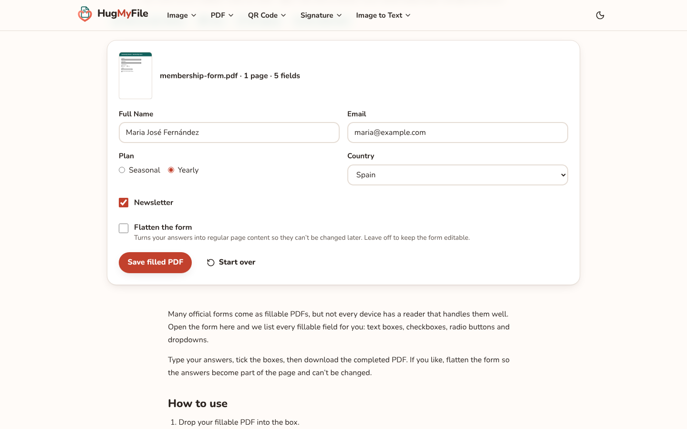 |
| 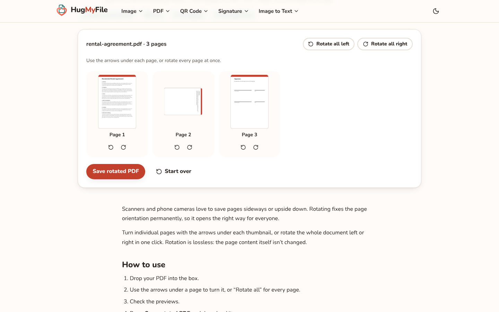 | 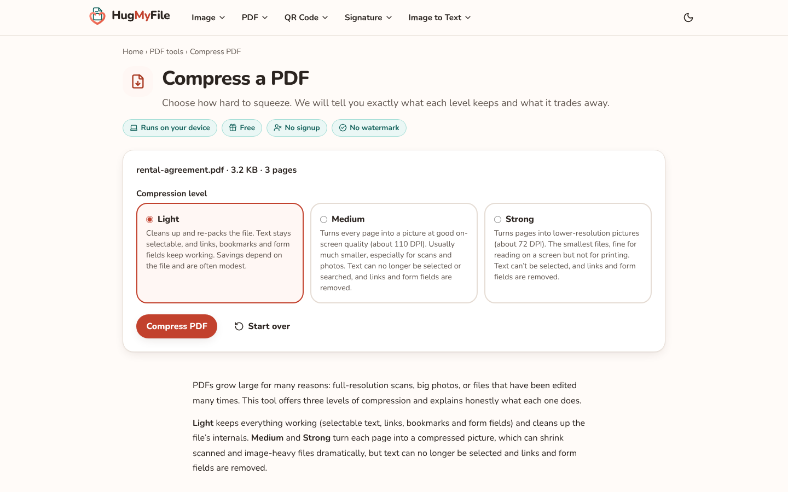 |
| 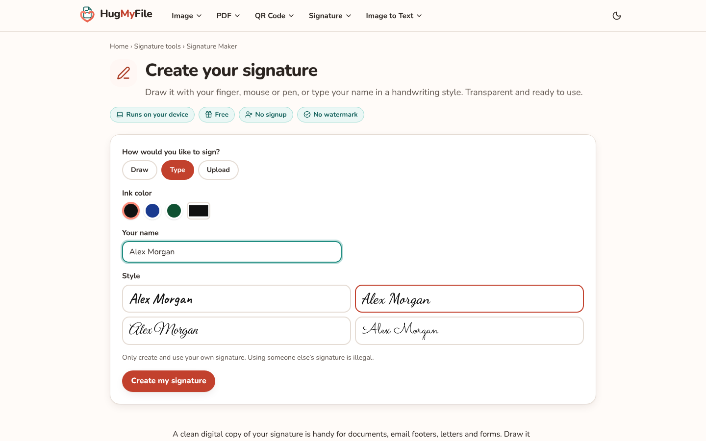 | 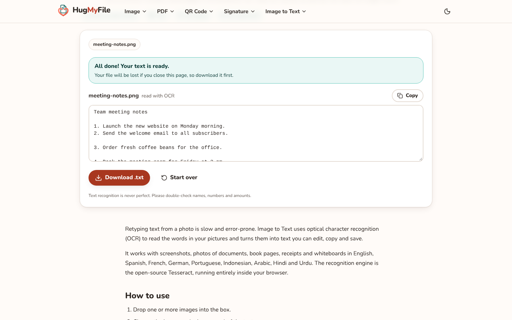 |

Phone (390×844): [home](docs/screenshots/03-home-mobile.png), [WiFi QR code](docs/screenshots/08-wifi-qr-code-mobile.png), [Compress Image](docs/screenshots/17-compress-image-mobile.png).

Banners and logo files are in `docs/brand`. Every image is generated from the real site with demo files made on the fly (no real people or documents):

```bash
npm run build
```

```bash
npm run showcase
```

## Quick start

You need Node.js 24 (see `.nvmrc`).

```bash
npm ci
```

```bash
npm run build
```

```bash
npm run preview
```

`npm run build` also copies the self-hosted pdf.js/tesseract assets into `public/vendor`
(`prebuild`), and afterwards checks licenses and file sizes (`postbuild`).

## Tests

```bash
npm run test:unit
```

```bash
npx playwright install --with-deps
```

```bash
npm run build && npm run test:e2e
```

Run a single browser with, for example, `npx playwright test --project=chromium-desktop --project=chromium-mobile`.
Projects: `chromium|firefox|webkit` × `desktop|mobile` (390×844). The GitHub Actions workflow
in `.github/workflows/test.yml` runs every browser on every push.

Test fixtures (images and PDFs) are generated by `tests/fixtures/generate.ts` the first time
the tests run.

## Where things live

| What | Where |
|---|---|
| Site name, address, contact email, ads and analytics switches | `src/config.ts` |
| Colors and fonts | `src/styles/global.css` (`@theme` block) |
| Logo | `src/assets/brand/logo-mark.svg` (then run `npm run brand` to refresh favicons, app icons and the OG image) |
| List of tools, titles and descriptions | `src/data/tools.ts` |
| Text on each tool page | `src/data/content/*.ts` |
| Tool code | `src/islands/*` (interface) and `src/lib/*` (engines and Web Workers) |
| Security and cache headers | `public/_headers` |
| Open-source credits | generated into `src/data/licenses.json` by `npm run licenses:update` |

## Licenses

Only permissively licensed code, fonts and data are shipped to visitors. After every build,
`scripts/license-report.mjs` lists every package that ends up in `dist/`, fails the build if one
is not permissive or is missing from the `/licenses` page, and writes
`reports/shipped-licenses.json`.

The project's own code is not open source (`"license": "UNLICENSED"`).
